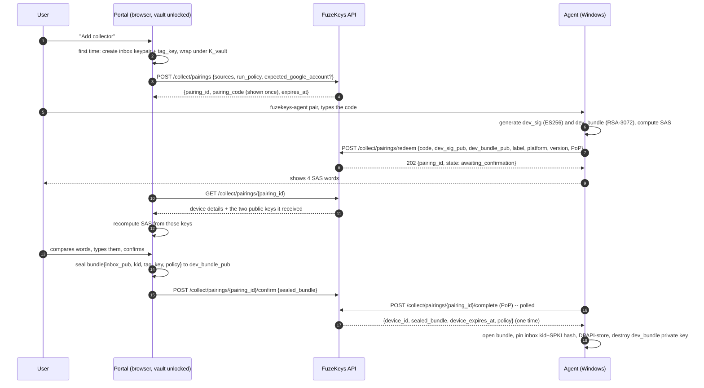
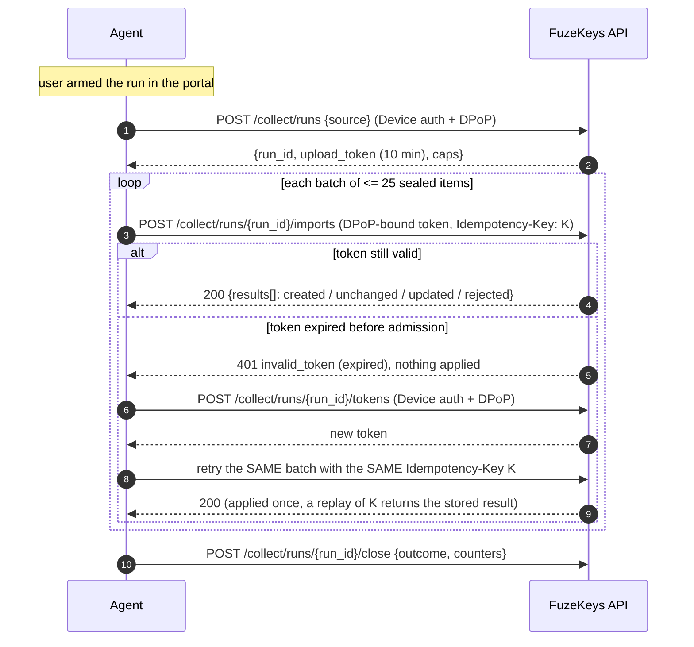
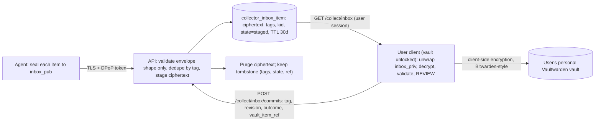

# ADR-003: Device pairing, scoped short-lived upload token, and sealing to the user's vault

* Status: Proposed (needs security sign-off)
* Story: FKY-13, unblocks FKY-4
* Hard requirement: **the device never holds the master key, the vault key, or any key that can decrypt what it uploads.** No server component ever sees a plaintext secret either.

## 1. Goals and non-goals

Goals: authenticate a paired local agent; authorise it to deposit (and only deposit) credential items for **one user**; make theft, replay and expiry harmless; let the user review before anything enters their vault.

Non-goals: letting the agent *read* the vault; agent-to-agent use of imported credentials (that stays with the broker doctrine in `backend/app/broker/README.md`); non-Windows collectors; unattended Google sign-in (O-1 in the README).

## 2. Keys and who holds them

| Key / secret | Created by | Lives where | Can decrypt items? |
|--------------|-----------|-------------|--------------------|
| Master key / vault key `K_vault` | User | The user's **client** (browser/mobile) RAM only, derived at unlock | Yes (user's client only) |
| **Inbox keypair** `inbox_pub` / `inbox_priv` (RSA-3072, OAEP-SHA-256) | Portal in the browser, first time a collector is added | `inbox_pub`: server + devices. `inbox_priv`: **wrapped under `K_vault`**, stored server-side as an opaque blob, unwrapped only in a user client | Only a user client with `K_vault` |
| `tag_key` (32 random bytes) | Portal in the browser | Wrapped under `K_vault` (opaque on server); a copy in each paired device's DPAPI blob | No (blind-index key only) |
| Device signing key `dev_sig` (ES256 / P-256) | Device at pairing | Device only (DPAPI blob; TPM-bound in v2) | No |
| Device bundle key `dev_bundle` (RSA-3072, ephemeral) | Device at pairing | Device RAM until the pairing bundle is opened, then **discarded** | Only the one-time pairing bundle |
| Upload token | Server per run | Device RAM; server stores only SHA-256 | No |
| Pairing code | Server | Shown once in the portal; server stores a peppered hash | No |

Properties that follow: the **server** holds `inbox_pub`, tags and ciphertext, and an opaque wrapped private key it cannot open. The **device** holds `inbox_pub`, `tag_key`, `dev_sig`; it cannot decrypt anything it uploaded.

## 3. Pairing flow (portal-initiated, SAS-confirmed)

Why portal-initiated plus SAS instead of the RFC 8628 device-authorization grant (code shown on the device, typed in the portal): the device-code flow is the classic target of consent phishing (an attacker shows the victim *their* device's code). Here the secret code originates in the authenticated portal, so a phisher cannot supply one; and a code leaked by shoulder-surfing or a screenshot is useless alone because a human must also confirm a matching **SAS** for the device that redeemed it.

### 3.1 Parameters

* **Pairing code:** 10 characters, Crockford Base32 (50 bits), displayed `XXXXX-XXXXX`, CSPRNG, **TTL 10 min, single use**. Server stores `HMAC(pepper, normalised_code)` only. It travels in a POST body, never in a URL (URLs get logged).
* **Guessing resistance:** 5 failed redeems burn the pairing; per-IP and per-user rate limits on `/pairings/redeem` (suggested 10/min/IP, 20/h/user); redeem failures are non-disclosing (same response for unknown, expired, burned, already-used).
* **SAS:** `SHA-256("fk-sas-v1" || SPKI(dev_sig_pub) || SPKI(dev_bundle_pub) || pairing_id)`, first 40 bits mapped to 4 words from a 1,024-word list. 40 bits makes a key-grinding MITM infeasible inside a 10-minute window. **The SAS comparison is a mandatory security control**, not a convenience: it is what stops a malicious or compromised server from substituting a device key during pairing (threat model A-5).
* **Portal confirmation** requires an active session **and** an unlocked vault (the browser must hold `K_vault` to wrap/seal), plus the user typing the SAS. The confirmation screen shows device label, OS/version, agent version, and the **server-observed** IP/geo and time, so "a device I do not recognise" is visible.
* **Confirm -> complete window:** 5 min. Bundle is retrievable **once**.
* **Device record:** server-minted identifier (per `governance/identifier-standard.md`: the service mints ids, clients never supply them; FKY-4 must register the `collector_device` / `collector_run` / `collector_pairing` types). Active devices per user: max 5.
* **Device lifetime:** 30 days sliding (extended by each successful run), 180 days absolute, then re-pair. Unused for 30 days -> `expired`.
* **Re-pairing:** a pairing may name `replaces_device_id`; on completion the old device is revoked atomically. A new keypair is always generated (keys are never migrated between installs). Because `tag_key` and the inbox key are **per-user**, dedupe continuity survives re-pairing.

### 3.2 What a stolen pairing code or token can and cannot do

| Stolen | Can | Cannot |
|--------|-----|--------|
| Pairing code (<=10 min, unconfirmed) | Redeem it from an attacker device, producing an `awaiting_confirmation` record the user sees in the portal with a **non-matching SAS** | Obtain a bundle, a token or a device identity without the victim confirming |
| Upload token alone | Nothing (needs the DPoP private key) | Upload |
| Upload token + DPoP key (device compromise) | Upload sealed junk for <= remaining token life, within run caps | Read anything; arm a run; touch another user's inbox |
| `device.bin` copied to another machine | Nothing (DPAPI user-scope + logon session) | Same |

## 4. Device-authenticated requests (no bearer secret at rest)

After pairing the device has **no long-lived bearer secret**. It authenticates by proof-of-possession of `dev_sig`, using DPoP (RFC 9449) proofs:

* Header `DPoP: <JWS>`; ES256; claims `htm`, `htu`, `iat` (+/- 60 s), `jti` (unique), `nonce` (server-provided via `DPoP-Nonce`, rotated every 5 min), and `ath` (hash of the access token when one is presented).
* The server verifies the signature against the key registered for `device_id`, rejects a reused `jti` (shared cache, 5 min), and rejects stale `iat`/`nonce`.
* Device-only endpoints (`GET /devices/{id}/commands`, `POST /runs`, `POST /runs/{id}/tokens`, `DELETE /devices/{id}`) use `Authorization: Device <device_id>` + a DPoP proof. A revoked/expired device gets the same non-disclosing `401`.

## 5. Runs and the upload token

### 5.1 Arming (who may start a collection)

* Default `run_policy = portal_armed`: the user clicks "Collect now" in the portal -> `POST /devices/{id}/arm` sets `armed_until = now + <=15 min` and `armed_sources`. The device learns it from a jittered 60 s poll (only while the tray is running and listening is enabled) or the user starts it from the tray after arming.
* `device_initiated` (user starts from the tray without the portal) is an explicit opt-in at pairing. `scheduled` is not offered for `gpm_web` (O-1); it may be offered for `wincred` later, gated by vault-unlock step-up.
* The server also enforces per-source frequency and the GPM cool-down/circuit breaker (ADR-001 section 5.3) at run creation.

### 5.2 The upload token

| Property | Value |
|----------|-------|
| Form | **Opaque** `fkc_` + 256-bit CSPRNG, base64url. Not a JWT, not a macaroon |
| At rest (server) | **SHA-256 only**, with run/device/user binding. Looked up on every request (no stateless validation, so revocation is instant) |
| Audience | Valid **only** at `POST /api/v1/collect/runs/{run_id}/imports` and `POST .../close` for **its own run**. Rejected by every other route, including all user-session routes |
| Scope | `collect:import` for `source` in {`gpm_web`,`wincred`} and one `run_id` |
| Sender constraint | Bound to the `dev_sig` thumbprint (`jkt`); every use needs a fresh DPoP proof with `ath` |
| TTL | **10 minutes** absolute from issue. No refresh token |
| Renewal | `POST /runs/{run_id}/tokens` signed by the device key; max 12 renewals; run deadline <= 4 h; only while the run is open and the device active. Old token invalidated on renewal |
| Caps per run | <= 2,000 items, <= 100 batches, <= 16 MiB total; per batch <= 100 items and <= 2 MiB; per item sealed blob <= 16 KiB; <= 30 requests/min |
| Idempotency | `Idempotency-Key` header on every import; server replays the stored response for 24 h |

### 5.3 Upload sequence and expiry mid-upload

Rules: expiry is checked **at admission**; a batch admitted before expiry completes atomically (all items processed, results recorded under `K`). A batch refused for expiry applied **nothing**. A dropped connection after admission is resolved by retrying with `K`, which returns the recorded result and never double-applies.

### 5.4 Revocation

| Trigger | Effect | Latency |
|---------|--------|---------|
| User revokes a device in the portal | Device `revoked`; all its open runs closed; all its tokens dead; device state wiped on its next contact (`device_revoked` -> agent self-unpairs) | Immediate (next request) |
| Device `unpair` / `uninstall` | Same, device-initiated | Immediate |
| Token TTL / run deadline / device expiry | Natural expiry | <= 10 min for tokens |
| Server anomaly rule (caps exceeded, high reject rate, impossible rate) | Device `suspended`, user notified | Immediate |
| `min_agent_version` raised | `426`, agent must update | Next request |
| Global kill switch (Unleash flag `collect-import-enabled`) | All collect routes -> `503` | Flag propagation |
| Inbox-key compromise / device theft with `tag_key` exposure | "Revoke all and rotate": revoke all devices, retire the inbox key, rotate `tag_key` (dedupe continuity is intentionally lost) | Immediate |

On revoke, **already-staged items from that device are retained but flagged `from_revoked_device`** and need explicit per-item confirmation at review (a compromised device could have injected hostile entries); the user may purge them in one action.

## 6. Why the broker `operation` grant is not reused as-is

The candidate mechanism was evaluated against the code. It is the right *pattern source*, not the right transport.

| Need | Broker (`backend/app/broker/`) | Verdict |
|------|--------------------------------|---------|
| Authenticate a consumer's PC | `redeem` trusts gateway headers `X-Verified-Repo` / `X-Verified-Spiffe` (OIDC repo claim or mTLS/SPIFFE) from `runtime.transport_from_headers`. A home PC has neither | **Mismatch** |
| User can revoke | `revoke` requires a `fuze-workload` token with audience `service:fuzekeys` (`routers/broker.py`). An end user cannot revoke | **Mismatch** |
| Grant owner is a user | `Grant.grantor_identity` is a workload principal; there is no `user_id` | **Mismatch** |
| Multi-request budget | Single-use by default; one redeem -> one derived token; no per-run counters, size or rate caps | **Gap** |
| Token form | HS256 JWT signed with `BROKER_SIGNING_KEY`, which **falls back to `SECRET_KEY`**, the same key `auth.get_current_user` verifies user sessions with (`runtime.get_broker_config`) | **Risk** (below) |
| Sender-constrained | Bearer; theft = use | **Gap** |
| Revocation/audit tables, hashed-at-rest, TTL clamp, clamp-to-scope, non-disclosing denials | Present and sound | **Reuse the patterns** |

Token-confusion note (reproduced locally with PyJWT 2.14.0; the backend pins 2.15.1, and `aud` validation without an expected audience is long-standing PyJWT behaviour, but FKY-4 should re-run the check against the pinned version): `get_current_user` calls `jwt.decode(token, key, algorithms=[ALGORITHM])` with no `audience`, and PyJWT raises `InvalidAudienceError` for any token carrying `aud`. Broker tokens carry `aud`, so a broker token is currently rejected as a user session **only by that accident**, not by design. Any future token minted under the shared key without `aud` would be accepted as a session. Therefore collect tokens must (a) not be JWTs signed with the session key, and (b) never share a signing domain with sessions. This ADR uses opaque, DB-validated tokens with no signing key at all. A separate hardening ticket should stop `BROKER_SIGNING_KEY` falling back to `SECRET_KEY` (threat model finding F-2).

Also rejected:

* **Existing SMS device auth** (`routers/sms.py`): a static non-expiring `X-Device-Key` bearer gated by one global enrollment token, with no user binding. Not an acceptable pattern for credential delivery.
* **Long-lived refresh token on the device:** a bearer secret on disk contradicts "no secret trace".
* **mTLS client certificates:** needs a device PKI and certificate lifecycle for little gain over DPoP at the application layer.
* **Server-side decryption of the inbox (Mode B):** a server-held inbox private key (KMS/OpenBao transit) would let the server decrypt. It keeps the device from decrypting but gives up server blindness, so a server compromise exposes every collected secret. Documented only as a fallback that needs explicit security approval (O-2); **not** designed here.

## 7. Sealing and the personal vault (the device never decrypts)

### 7.1 Item plaintext (before sealing; canonical JSON, RFC 8785)

`{ "v":1, "kind":"login"|"generic_credential", "source":"gpm_web"|"wincred", "origin":"<host or target>", "username":"...", "password_b64":"...", "encoding_hint":"utf8|utf16le|binary", "note":"...", "source_ref":"<Credential Manager TargetName, if any>", "collected_at":"<RFC3339>" }`

### 7.2 Envelope (`fk-seal-v1`)

Reuses the repository's existing, tested hybrid scheme (`backend/app/broker/envelope.py`): a fresh 256-bit DEK, **AES-256-GCM** over the item, DEK **wrapped RSA-OAEP-SHA-256 to `inbox_pub`**. Two deliberate changes for FKY-4, both additive so existing envelope tests keep passing:

1. Bind an **AAD**: `"fk-collect-v1|" + device_id + "|" + dedupe_tag + "|" + revision_tag + "|" + kid + "|" + kind`. A server (or anyone) can no longer move a ciphertext under a different tag/device without the browser's decrypt failing.
2. Inbox keys are **RSA-3072** (envelope.py's helper defaults to 2048).

Why RSA-OAEP rather than HPKE for v1: WebCrypto (browser) supports RSA-OAEP + AES-GCM natively and Go's standard library supports both, so no third-party crypto lands in the agent or the portal. The envelope carries an `alg` field; v2 can move to **HPKE (RFC 9180)** (`crypto/hpke` exists in Go 1.26; the browser would need a vetted JS implementation) without a flag day.

### 7.3 Blind-index tags (dedupe without decrypting)

* `dedupe_tag = base64url(HMAC-SHA256(tag_key, "tag" 0x00 NFC-lowercase(origin_host) 0x00 NFC(username)))` truncated to 16 bytes. Scope on the server is **(user_id from the authenticated token, never the body, dedupe_tag, source)**.
* `revision_tag = base64url(HMAC-SHA256(tag_key, "rev" 0x00 canonical_plaintext))` truncated to 16 bytes: detects "same entry, changed content".
* The server learns only equality (same / changed / new) per user. It never learns origin or username. Residual: whoever has **both** a stolen device's `tag_key` and the DB can test guesses against the tags; response is "revoke all and rotate" (section 5.4).
* Clear metadata on the wire is limited to `source`, `kind`, `kid`, the two tags and sizes. **Origin is not sent in clear by default**, deliberately stricter than the existing `accounts.website_domain` plaintext column.

### 7.4 Staging, review, and commit to the personal vault

* The server **never** sees plaintext and holds no key that can decrypt a staged item. The "Vault seam" for this feature is therefore a **client-side committer** (`PersonalVaultCommitter`): the user client produces Vaultwarden/Bitwarden ciphers encrypted under `K_vault` by the standard client library (the repo rule from the identity-vault spec: "FuzeKeys must not implement its own field-level cryptography"), and the backend stores only the returned `vault_item_ref`. This is consistent with the vault seam doctrine (`backend/app/broker/vault.py`: Postgres holds handles, the vault holds secrets).
* **Review is mandatory before commit** (no auto-commit). The review UI shows decrypted origin/username (password masked), the source, device and run, and flags: new vs update vs duplicate, `from_revoked_device`, non-HTTPS origins, punycode/homograph origins, and oversize or control-character fields. Strings are rendered as **text only**; URLs are shown but never auto-opened; only `https`, `http`, and `android://` style origins are accepted.
* **Additive only:** an import never deletes or overwrites a vault item automatically. An `updated` revision is offered as an update the user accepts.
* **Retention:** staged ciphertext purged on commit/dismiss or after 30 days. Tombstones (tag, revision_tag, source, state, `vault_item_ref`, timestamps) contain no ciphertext and let a repeat import of an identical revision return `unchanged`. A user "purge inbox" action deletes both.
* **Dependency:** a Vaultwarden adapter and a client-side vault key in the portal do not exist today (README "Verified facts"); see O-2/O-3.

## 8. Server data model (logical; FKY-4 owns the migration)

| Table | Key columns (no secrets) |
|-------|--------------------------|
| `collector_user_keys` | `user_id`, `kid`, `inbox_pub`, `wrapped_inbox_priv` (opaque), `wrapped_tag_key` (opaque), `created_at`, `retired_at` |
| `collector_pairing` | server-minted id, `user_id`, `code_hmac`, `state`, `failed_attempts`, `expires_at`, `dev_sig_pub`, `dev_bundle_pub`, `sealed_bundle`, `replaces_device_id` |
| `collector_device` | server-minted id, `user_id`, `dev_sig_pub`, `jkt`, `label`, `platform`, `agent_version`, `state` (active/suspended/revoked/expired), `run_policy`, `armed_until`, `armed_sources`, `expires_at`, `cooldown_until`, `block_streak` |
| `collector_run` | server-minted id, `device_id`, `user_id`, `source`, `state`, `deadline`, counters, `outcome`, `block_reason` |
| `collector_token` | `sha256`, `run_id`, `device_id`, `user_id`, `jkt`, `expires_at`, `renewals` |
| `collector_inbox_item` | `user_id`, `dedupe_tag`, `source`, `revision_tag`, `kid`, `sealed` (bytes), `device_id`, `run_id`, `state` (staged/committed/dismissed), `from_revoked_device`, `created_at`, `purge_after`; **unique (`user_id`,`dedupe_tag`,`source`)** |
| `collector_idempotency` | `device_id`, `run_id`, `key`, `request_sha256`, `response`, `expires_at` |
| `collector_audit` | `ts`, `user_id`, `device_id`, `run_id`, `event`, `counts`, `reason_code` (never a value) |

Postgres here holds **transient ciphertext** that is not a system of record. That is a reviewed deviation from the identity-vault lock "Postgres keeps no secrets" because the ciphertext is sealed to a key the server does not have (O-5 asks security to confirm; the alternative is an OpenBao KV staging path).

## 9. Authorization notes for FKY-4

* Every user-session route filters by the authenticated principal; ids in URLs are never trusted for ownership (BOLA). Add `fuzekeys_CollectorDevice` and `fuzekeys_CollectInboxItem` resource types to the platform policy (`registration/policy.json`) and extend `owner_authz.require_owner_permission` (today it accepts only `Identity` and `Account`).
* Add every new route to `docs/security/mounted-route-authorization.json` and `governance/` route lists as the existing gates require; routes under `/api/v1/collect/` satisfy `gate-api-version`.
* Pre-auth pairing endpoints (`/pairings/redeem`, `/pairings/{id}/complete`) are the only unauthenticated-by-session routes besides health; they are rate-limited and non-disclosing.
* All create bodies are `additionalProperties: false` and contain no client-chosen resource ids (`gate-identifier` C1/C2). The `Idempotency-Key` header and the blind-index tags are not resource identifiers.

## 10. Acceptance criteria for FKY-4 (derived)

1. Pairing: wrong/expired/reused/burned codes are indistinguishable; SAS mismatch cannot complete; unconfirmed pairing yields no token.
2. Token: reject when expired, wrong run, wrong device, wrong `jkt`, missing/stale/replayed DPoP, wrong route, and after revoke (same-request-latency).
3. Expiry mid-upload: the batch retried with the same `Idempotency-Key` is applied exactly once.
4. A device with a revoked pairing cannot mint tokens or upload and wipes itself.
5. Server-side test: no code path in the `collect` module imports `encrypt_field`/`decrypt_field`/`get_global_encryption_manager` or reads `inbox_priv`.
6. Envelope: AAD mismatch fails decrypt; unknown `kid`/`alg` rejected at the API; browser decrypt round-trips an agent-produced envelope (cross-language vector test, Go seal -> WebCrypto open).
