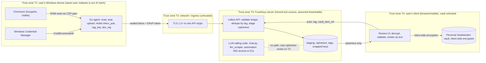

# Threat model: collect-identities data path (FKY-13)

* Status: Proposed. Design review only (no code exists). Needs recorded human sign-off in FKY-13 before FKY-4 starts.
* Method: asset and trust-boundary enumeration, invariant proofs by construction, STRIDE per component, then explicit edge cases and attack scenarios. Claims are tagged **[verified]** (artifact read; evidence cited), **[inferred]** (reasoned; the check that would settle it is named) or **[unknown]**.
* Related: [ADR-001](adr-001-gpm-browser-scrape-collector.md), [ADR-002](adr-002-go-agent-packaging-and-windows.md), [ADR-003](adr-003-device-pairing-and-upload-token.md), [contract stub](../contracts/collect-import.v1.yaml).

## 1. Assets and data classes

| ID | Asset | Class | Where it may exist (plaintext) |
|----|-------|-------|--------------------------------|
| D1 | Collected credentials (passwords, usernames, notes, Credential Manager blobs) | **Secret / PII** | Chromium and agent RAM on the device (seconds); user client RAM during review. **Nowhere else** |
| D2 | Sealed items (`fk-seal-v1`) | Confidential ciphertext | Network (inside TLS), server staging table, backups |
| D3 | Blind-index tags (`dedupe_tag`, `revision_tag`) | Pseudonymous metadata | Server, device |
| D4 | `K_vault` / master key | **Crown jewel** | User client RAM only |
| D5 | `inbox_priv` (wrapped), `tag_key` (wrapped) | Secret, wrapped | Server (opaque), user client after unwrap |
| D6 | Device signing key `dev_sig`, `tag_key` copy | Device secret (not a user credential) | DPAPI blob on device |
| D7 | Upload token, pairing code | Short-lived bearer secrets | Device RAM / portal screen; hashed on server |
| D8 | Google session (cookies) during a GPM run | Bearer secret with full account power | Incognito Chromium RAM |
| D9 | Logs, audit rows, telemetry, error bodies | Must contain none of D1, D2 content, D4-D8 | Agent log, server logs, ingress logs |

## 2. Data flow and trust boundaries

Trust assumptions: T1 is trusted not to be root-compromised but **same-user malware is a stated residual risk**; T3 is **not trusted with plaintext or keys by design** (a breach of T3 must not reveal D1); T4 is trusted only while the user has the vault unlocked.

## 3. Invariant proofs

### INV-1 Tokenize-before-send (nothing raw reaches an LLM provider)

**What exists today [verified].** The PII tokenizer protects LLM-bound text at a LiteLLM `pre_call` guardrail and Claude Code hooks (`pii-tokenizer/README.md`). It is **disabled in the production chart** (`deploy/helm/fuzekeys/values.yaml`: `tokenizer.enabled: false`, `litellm.enabled: false`) and its hooks are **fail-open** (`pii-tokenizer/docs/ASSUMPTIONS.md` assumption 5). Meanwhile `backend/app/routers/chat.py` calls `openai.ChatCompletion` **directly**, forwarding the user message and an arbitrary caller `context` dict. So in production, tokenize-before-send is **not enforced on the backend's own LLM calls**.

**Therefore this design does not depend on the tokenizer.** It makes the property structural:

> Let H = components that ever hold collected plaintext D1 = {Chromium + agent RAM on T1, user client RAM on T4}. Let P = components that can send text to an LLM provider = {LiteLLM proxy, `chat.py`, `llm_scraper_service`, automation/background services, any developer Claude Code session}. The design makes **H and P disjoint**: no member of P runs on T1 or T4-as-collect-review, and the only collect state on T3 (where P lives) is ciphertext whose key T3 cannot obtain.

| Step | Mechanism | Evidence / test |
|------|-----------|-----------------|
| 1. Device is LLM-free | Agent has no LLM SDK or LLM endpoint; HTTP transport dials only the API origin; DOM parsing is deterministic (no LLM fallback, ADR-001 s3.3) | Import-allowlist lint (`depguard`), `go list -deps` check, egress-allowlist unit test |
| 2. Server sees ciphertext only | `fk-seal-v1` to `inbox_pub`; `inbox_priv` exists only wrapped under `K_vault` | Test: collect module never imports `encrypt_field`/`decrypt_field`/`get_global_encryption_manager`; DB fixture contains no plaintext canary after an end-to-end run |
| 3. Server LLM code cannot reach D1 | No plaintext exists on T3 to read; `collect` tables are not referenced by chat/context builders | Grep/AST test: `app.routers.chat`, `llm_scraper_service`, `automation` do not import `app.collect*` |
| 4. Review UI is not an LLM context source | The review page must never populate the chat `context` payload that `chat.py` forwards to OpenAI | Frontend test: chat widget payload on the review route contains no inbox/decrypted fields |
| 5. Tests and fixtures are synthetic | No real collected data in repo, CI or developer Claude sessions; hooks stay as the secondary dev-time guard | gitleaks (existing Harden Gate), fixture review |
| 6. After commit | Later LLM use of vault items goes through the existing broker/tokenizer doctrine, unchanged | Out of scope; not altered by this design |

**Conclusion INV-1: preserved by construction**, conditional on steps 1-5 being implemented and tested. It holds **even though the tokenizer is off in production and fail-open**, which is the stronger position. A user pasting a secret into chat is the pre-existing "user's own typed prompt" limitation (`ASSUMPTIONS.md`), unchanged.

### INV-2 Vault encryption (secrets at rest only as ciphertext under the user's key)

| Location | State | Mechanism |
|----------|-------|-----------|
| Device disk | No plaintext. Only `device.bin` (DPAPI: signing key, `tag_key`, pinned `inbox_pub`) | ADR-001 s7 controls; canary test |
| Device RAM | Plaintext for seconds, zeroed after seal | `Secret` byte type, `VirtualLock`, suspend handler |
| Network | TLS **and** end-to-end sealed envelope (a TLS-terminating proxy or compromised ingress sees ciphertext) | ADR-003 s7.2 |
| Server DB / backups / logs | Ciphertext + tags + wrapped keys. Cannot be opened without `K_vault` | Server never holds `K_vault`; AAD binds each ciphertext to its tag and device |
| User client | Plaintext only in RAM while reviewing | Standard client behaviour; no persistence of decrypted items |
| Personal vault | Bitwarden-style client-side encryption under `K_vault` by the standard client library | FuzeKeys implements no field-level crypto (identity-vault spec s2) |

**Conclusion INV-2: preserved** against a passive breach of T3 (DB, backups, logs, even `SECRET_KEY`). **Condition (O-2):** it holds against an **active** T3 compromise only if `K_vault` is derived from a secret that never reaches the FuzeKeys API. Today `POST /api/v1/auth/login` takes `master_key` in the request body and calls `set_global_encryption_manager(user_data.master_key)` **[verified: `backend/app/routers/auth.py`, `backend/app/utils/encryption.py`]**, so the server sees the master key at login. The vault key for this feature MUST therefore be the Vaultwarden/Bitwarden master password entered only into the vault client, and the collect module MUST NOT use the Fernet global manager (finding F-1).

### INV-3 No raw PII or secret material in logs

Controls (each needs a test in FKY-4):

| ID | Control |
|----|---------|
| L-1 | Agent logs are allow-listed structured fields only (counts, reason codes, versions, durations). `Secret` implements `slog.LogValuer` -> `[redacted]`; `MarshalJSON` errors; no `fmt.Sprintf` of item data anywhere. Release builds use `GOTRACEBACK=none` and a top-level `recover()` that logs the error class only |
| L-2 | Server: request bodies for `/api/v1/collect/*` are never logged; `Authorization`, `DPoP` headers and `pairing_code` are redacted at the app and ingress; the pairing code is a body field, never a URL |
| L-3 | Server error bodies are RFC 9457 problems with fixed codes; `detail` never echoes submitted data (contract `Problem` rule) |
| L-4 | `collector_audit` stores event, ids, counts and reason codes only |
| L-5 | **Loguru `diagnose=True` must not apply to collect code paths.** It is enabled on every sink today **[verified: `backend/app/utils/logging.py`]** and renders local variable *values* in exception tracebacks. Collect handlers hold only ciphertext, which limits the damage, but request-model locals, tokens and codes would still leak. Set `diagnose=False` (finding F-3) |
| L-6 | Telemetry from the agent is counters and codes only. A structural fingerprint (hash of the element-role tree) is the only DOM-derived datum ever sent |
| L-7 | Tags are pseudonymous but are not written to logs either (counts only) |
| L-8 | Redaction test: run an end-to-end collect with `LOG_LEVEL=DEBUG` on both sides using canary plaintext, canary ciphertext markers, a canary token and a canary code; grep the agent log, server stdout/file logs, ingress logs and audit table for them. Zero hits is the pass condition |

**Conclusion INV-3: preserved if L-1..L-8 are implemented.** Pre-existing PII-in-logs examples elsewhere (F-5) are not touched by this design but show why L-8 is a gate, not a nicety.

## 4. STRIDE per component (summary)

| Component | S | T | R | I | D | E |
|-----------|---|---|---|---|---|---|
| Pairing | Code phishing/leak -> SAS + portal-originated code (A-4) | Key swap by server -> SAS (A-5) | Audit events | Code in URL/logs -> body only (L-2) | Redeem flooding -> rate limits, burn after 5 | Device gains arming power -> no; arming is portal-only |
| Device auth | Stolen token -> DPoP (A-3) | Proof tamper -> signature | `collector_audit` | Key theft -> DPAPI, revoke (A-1) | Poll abuse -> jittered poll, limits | n/a |
| Import API | Cross-user write -> user from token only (A-11) | Hostile payload -> shape validation, quotas (A-6) | Idempotency log | Verbose errors -> fixed codes | Staging exhaustion -> caps (A-14) | Token used off-route -> audience check |
| Inbox / commit | Forged item from compromised device -> review (A-7) | Ciphertext swap -> AAD | Tombstones | Server reads D1 -> impossible (INV-2) | Purge TTL | n/a |
| Agent | Fake binary -> signing, pinned publisher (A-10) | Recipe redirect by server -> recipes compiled in (A-5) | Local log (counts) | Memory/disk/log leak -> ADR-001 s7 | Loop on block -> stop + cool-down (A-8) | Over-collection -> origin/account allowlist (A-12) |

## 5. Edge cases

| ID | Case | Required behaviour | Test |
|----|------|--------------------|------|
| E-1 | **Re-pairing** (reinstall, new PC, lost key) | New keypair always; optional `replaces_device_id` revokes the old device atomically; `tag_key`/inbox key are per-user so dedupe continues; stale pairing records expire in 10 min; two live pairings for one user allowed (max 5 devices) | Re-pair then re-import: all items `unchanged`; old device gets `401` |
| E-2 | **Duplicate imports** (same run replay, repeated runs, overlapping sources, two PCs) | Same `(user, dedupe_tag, source)` + same `revision_tag` -> `unchanged`; new revision -> `updated` (restaged, never auto-applied); same batch replay -> stored response; repeated tag in one batch -> second `rejected: duplicate_in_batch`; cross-source collisions are separate rows merged by the user client | Property test: N replays leave exactly one row and identical results |
| E-3 | **Token expiry mid-upload** | Expiry checked at admission; expired -> `401`, nothing applied; device renews (<=12 times) and retries the same batch with the same `Idempotency-Key`; an admitted batch completes atomically; renewal past run deadline refused -> run closes `partial` | Fake clock test around the boundary; kill connection after admission and retry |
| E-4 | **Chrome version / profile variation** | Support stable N..N-2 + Edge; version gate by `Browser.getVersion`; non-default `--user-data-dir` (Chrome 136+ requirement); enterprise policy blocking incognito -> refuse, never fall back to a persistent/real profile; multiple Chrome profiles irrelevant; multiple signed-in Google accounts -> abort `ambiguous_account`; locale-independent selectors; recipe mismatch -> abort `recipe_mismatch` | Matrix CI against stable/N-1/N-2/Edge with a mock GPM; policy-blocked fixture |
| E-5 | **Clock skew** | DPoP `iat` window +/-60 s with server `DPoP-Nonce`; device derives offset from the server `Date` header (never changes the system clock); beyond 5 min skew, surface a tray error | Skew +/-2 min and +/-10 min tests |
| E-6 | **Agent crash / kill mid-run** | Job Object kills Chromium; temp dir swept at next start; run times out server-side and closes `aborted`; restart is safe because imports are idempotent; no secrets persisted to resume | Kill-agent test + leak audit |
| E-7 | **Sleep / hibernate mid-run** | `ES_SYSTEM_REQUIRED` during runs; on suspend event zero buffers, kill browser, abort `suspended`. Hibernation could page RAM to `hiberfil.sys` -> BitLocker/Device Encryption preflight (override requires explicit acknowledgement) | Simulated power broadcast test; preflight unit test |
| E-8 | **Server unreachable / slow** | Bounded in-memory buffer (<=100 sealed items); back-pressure pauses the scrape; exponential retry with jitter; abort after the run deadline; nothing spools to disk | Network fault injection |
| E-9 | **Inbox key retire / rotation** | v1 has **no silent rotation**: rotating means "revoke all devices and re-pair", because a server-delivered new public key would let a malicious server substitute its own (A-5). Items sealed to a retired `kid` stay decryptable by the user client (the key ring keeps old private keys wrapped) | Unknown `kid` rejected at API; ring decrypt test |
| E-10 | **Multiple Windows users / fast user switching** | `device.bin` is DPAPI user-scope: another Windows user cannot use the pairing; CredEnumerate returns only the calling logon session's credentials; refuse to run non-interactively | Two-user VM test |
| E-11 | User deleted the vault item, then re-imports | Tombstone says `committed`; identical revision -> `unchanged` (not re-staged). User can "forget" a tombstone or purge the inbox to allow re-import | State machine test |
| E-12 | Partial or blocked run | Run closes `partial`/`blocked`; portal shows "incomplete, N of unknown"; never reported as complete; imports so far remain staged and valid | Close-outcome tests |
| E-13 | Odd Credential Manager blobs (UTF-16LE, UTF-8, binary, oversize, empty) | `encoding_hint` carried; >limit skipped with a counter; never assumed text; zeroed after seal | Fixture test |
| E-14 | Non-web GPM entries (`android://` apps), notes, huge notes, control characters | Accepted `origin` schemes `https`, `http`, `android`; note capped; control characters stripped on render | Review-UI test |
| E-15 | Server `min_agent_version` raised during a run | Next call -> `426`; run aborts cleanly, agent updates, user re-arms | Version-gate test |

## 6. Attack scenarios

| ID | Attack | Impact if unmitigated | Mitigations | Residual |
|----|--------|----------------------|-------------|----------|
| **A-1** | **Stolen device** (powered-off disk image, or unlocked laptop) | Impersonate the agent; read local creds | DPAPI user-scope `device.bin` (offline image gives nothing without the user's logon secret); device holds no master key, no vault key, cannot decrypt uploads; `portal_armed` default means a thief cannot start runs without the victim's portal session; user revokes in the portal (immediate) and uses "revoke all and rotate" if `tag_key` exposure is a concern; stolen device's staged items are flagged | An attacker already logged in as the user can read Credential Manager directly, with or without our agent (out of our control) |
| **A-2** | **Revoked pairing still used** (attacker keeps the exe and key) | Continued uploads | Token validation is a DB lookup on every request (no stateless trust); revoke kills device, runs and tokens at once; non-disclosing `401`; on `device_revoked` the agent self-unpairs and wipes `device.bin`; staged items from the device are flagged `from_revoked_device` | Attacker can still scrape their own memory locally; they simply cannot deliver it to FuzeKeys |
| **A-3** | **Replayed upload token / request** | Duplicate or forged writes | Token useless without the DPoP key; each proof carries `jti` (cached 5 min, shared across replicas), `iat` window, server `nonce`, `htm`/`htu`/`ath`; token valid only on its run's `/imports`+`/close`; 10 min TTL; `Idempotency-Key` makes accidental replays harmless; run caps | Replica cache outage fails closed (reject), not open |
| **A-4** | **Pairing-code interception, brute force, device-code phishing** | Attacker device paired | Portal-originated 50-bit code, 10 min, single use, 5-failure burn, per-IP/user limits; code useless without human **SAS confirmation** of that device; confirmation screen shows server-observed IP/OS/time; the phisher cannot supply a code because codes originate in the victim's portal | A user who ignores a SAS mismatch pairs the attacker's device (it can then only deposit sealed, reviewable items; see A-7) |
| **A-5** | **Compromised or malicious server** (key substitution at pairing, malicious recipe/URL instructions, serving a hostile update) | Server learns future uploads, or turns agents into scrapers | Pairing bundle is sealed **by the browser** to a device key bound into the SAS: a swapped device key changes the SAS and the user aborts; `inbox_pub` is pinned (`kid` + SPKI hash) after pairing and never re-fetched; no rotation without re-pair (E-9); the server cannot send URLs, selectors, scripts or accounts (compiled-in recipes, allowlisted origins); updates are Ed25519-manifest + Authenticode + pinned publisher | If the user skips the SAS comparison on a compromised server, secrecy against that server is lost for that device. The SAS is therefore a **mandatory control** and the UI must not allow "skip" |
| **A-6** | **Malformed or hostile bulk payload** (oversize, deep JSON, duplicate keys, bad base64, `alg` downgrade/unknown `kid`, duplicate tags, tag/ciphertext mismatch, SQL/JSON injection, decompression bomb, slow-loris) | Parser DoS, storage abuse, injection | Strict schema, `additionalProperties:false`, regex-bounded base64url, length bounds, `alg` and `kid` allow-lists, no request compression accepted, body limit before parse (2 MiB), per-item/batch/run/user quotas, parameterised SQL, duplicate-key JSON rejected, per-item failure isolation, `413/415/422` with fixed codes; server validates **shape only** because it cannot see plaintext | Server cannot detect malformed *plaintext*; that is validated in the user client (A-7) |
| **A-7** | **Poisoned or hostile plaintext** from a compromised device (phishing login URLs, XSS strings, homograph origins, very long fields, control chars) | Autofill/phish or XSS in the review UI | Mandatory review; no auto-commit; render as text; scheme allow-list; punycode display; size caps; flags for non-HTTPS, `from_revoked_device`, `updated` revisions; import is additive and never overwrites automatically | A careless user approving a malicious item. Mitigated by review UX and device provenance |
| **A-8** | **Scrape throttled, blocked, challenged, or account actioned by Google** | Partial data, account lock, abuse flags | Polite throttle (ADR-001 s5), stop on first challenge, no CAPTCHA solving, server-side cool-down + circuit breaker, consent text, partial runs reported honestly (E-12) | Google may still restrict the account (product/legal risk R-1 / O-6) |
| **A-9** | **Same-user malware / infostealer** | Reads D1 from Chromium RAM or Credential Manager itself | Out of scope for prevention (a same-user process can already call `CredEnumerateW`). Reduced exposure: short runs, incognito, no persistence, no listening port, DPAPI-wrapped device secrets, nothing for malware to steal at rest from our directories except a revocable device key | Accepted, documented |
| **A-10** | **Supply chain / fake update / binary planting** | Trojaned agent steals D1 | Authenticode (bot/OIDC signer) + pinned publisher + Ed25519 manifest + `min_agent_version`; SBOM + provenance; Actions pinned by SHA; reproducible build; per-machine MSI option against planting | Per-user default install is user-writable (documented) |
| **A-11** | **Cross-tenant IDOR / BOLA** on devices, pairings, inbox | Read or revoke another user's | `user_id` always from the authenticated principal; `(user_id, tag, source)` unique key; non-owner and missing are indistinguishable (`404`); resource types added to platform policy; negative tests per route | Depends on FKY-4 discipline; covered by acceptance tests |
| **A-12** | **Agent pointed at someone else's Google account** | Unconsented collection | Origin allowlist, expected-account binding, single-account rule, no credential entry, interactive-user-only, Workspace attestation, consent record (ADR-001 s6) | A user who already knows another person's Google credentials has already compromised that person |
| **A-13** | **Server data theft** (DB dump, backup leak, insider) | Mass credential exposure | DB holds only sealed items, tags and wrapped keys; no key on T3 (INV-2) | Tag-guessing only with a stolen device `tag_key` too (rotate on theft). Active T3 compromise during login: see O-2 |
| **A-14** | **Quota / staging exhaustion DoS** | Disk or CPU exhaustion | Per-user staged cap (10,000), per-run caps, rate limits, TTL purge (30 d), global kill switch flag | Authenticated abuse bounded by caps |
| **A-15** | **Log / telemetry / crash leakage** | Secret or PII in a sink | L-1..L-8, crash-dump suppression, no screenshots/tracing/clipboard | F-3 and F-5 are pre-existing leaks outside collect |

## 7. Findings in the existing repo (hand-off, not fixed here)

Each is tracked for the owning implementer; severities are for the *collect* feature's risk, not a full appsec rating. Evidence is the file read at `origin/master` e0c5837.

| ID | Finding | Evidence | Severity | Owner |
|----|---------|----------|----------|-------|
| F-1 | Server receives the master key at login and stores it in a **process-global** Fernet manager (shared across users and requests); `MASTER_KEY_SALT` silently defaults to `"default_salt"` | `auth.py` (`set_global_encryption_manager(user_data.master_key)`); `encryption.py` (`_global_encryption_manager`, `os.getenv("MASTER_KEY_SALT", "default_salt")`) | **High** (pre-existing; also violates the vault-key requirement for this feature) | backend-engineer; production value of `MASTER_KEY_SALT` is **[unknown]**, check the sealed secret |
| F-2 | `BROKER_SIGNING_KEY` falls back to `SECRET_KEY`: broker tokens and user sessions share a signing key. Confusion is blocked today only by PyJWT rejecting `aud` when none is expected | `broker/runtime.py:get_broker_config`; local PyJWT reproduction (ADR-003 s6) | Medium | backend-engineer / devops (separate keys, remove fallback) |
| F-3 | Loguru `diagnose=True` on console and both file sinks (`backtrace=True` on errors) renders variable values in tracebacks | `utils/logging.py` | Medium | backend-engineer |
| F-4 | `chat.py` sends the user message and an arbitrary `context` dict to OpenAI with no tokenizer; tokenizer and LiteLLM are disabled in the production chart | `routers/chat.py:get_ai_response`; `values.yaml` | Medium (relevant because INV-1 for collect relies on structural isolation rather than the tokenizer) | backend-engineer + security (enable and review the tokenizer path, or constrain `context`) |
| F-5 | PII in logs: `log_security_event("user_registered", details={"email": ...})`; `SmsOtpReceived.__repr__` includes `otp_code` | `auth.py` register; `models/sms.py` | Medium | backend-engineer |
| F-6 | Existing device auth (`X-Device-Key`) is a static, non-expiring, non-user-bound bearer behind one global enrollment token. Do not reuse as the collect pattern | `routers/sms.py`, `models/sms.py` | Informational for collect | backend-engineer (migration already tracked in `mounted-route-authorization.json` as `device_proof_platform_migration_gap`) |
| F-7 | No Vaultwarden adapter in the vault seam and no Vaultwarden in the Helm chart | `broker/vault.py`; `grep -ri vaultwarden deploy/` empty | Blocker for committing to a personal vault in prod (O-2) | devops-engineer / FuzeInfra via `@fuze` |

## 8. Residual risks accepted by this design

1. Same-user malware on the device (A-9).
2. A user who confirms a pairing despite an SAS mismatch (A-4/A-5).
3. User approval of a hostile staged item (A-7).
4. Google may restrict an account that is scraped (A-8, O-6).
5. DPAPI protects against other users and offline theft, not the same logon session.
6. Tag-guessing with stolen `tag_key` plus a DB dump (rotate on theft).

## 9. Security acceptance tests FKY-4 must ship (gate to merge)

1. Canary test: no plaintext on device disk, crash dump dirs or agent log (UTF-8 and UTF-16LE).
2. Redaction test L-8 across agent, server, ingress and audit sinks.
3. Isolation tests for INV-1 steps 1-4 (import allow-list, no `encrypt_field` in collect, no chat import of collect, chat payload has no inbox fields).
4. Token matrix: expired, wrong run/device/key/route, replayed proof, revoked, missing nonce; replay and expiry-boundary under a fake clock.
5. Exactly-once import under retry (same `Idempotency-Key`), cross-run and cross-source duplicates, intra-batch duplicates.
6. Pairing: burn after 5 failures, indistinguishable failures, SAS mismatch cannot complete, key swap detected.
7. Cross-user negative tests on every route (BOLA), plus platform-policy registration of the new resource types.
8. Hostile payload corpus (A-6) with bounded time/memory.
9. Throttle/backoff tests with a fake clock; every block signal stops the run; cool-down enforced server-side.
10. Windows install/uninstall residue test and update tamper tests (ADR-002 s9).
11. Cross-language envelope vector: Go seal -> WebCrypto open, with AAD.

## 10. Open decisions and blockers for FKY-4

| ID | Item | Needed from |
|----|------|-------------|
| **O-1** | D-1 asks for both "no human in the loop" and "no secret trace on disk". Across runs these conflict for Google sign-in: a remembered Google session is itself a disk-resident bearer secret. This design keeps "no trace" and requires the user to complete Google sign-in/MFA at the start of each run (the scrape itself is automated). Unattended scheduled GPM runs need an explicit owner decision to relax "no trace" | **Owner** |
| **O-2** | Prerequisites not present today: (a) a Vaultwarden adapter and Vaultwarden in prod (F-7); (b) a portal that holds a vault key client-side, derived from a secret never sent to FuzeKeys' own login (F-1). Without (b) the fallback is "Mode B" (server-held inbox key), which breaks server blindness and needs separate security approval; it is **not** designed here | Owner + security + devops (FuzeInfra) |
| **O-3** | Relationship between the user's personal vault and persona collections in the identity-vault design (locked decisions 3 and 5 use a service-account silo). This design commits to the user's own personal vault with client-side crypto | Owner / architect |
| **O-4** | Authenticode identity: which legal entity buys it (Azure Artifact Signing eligibility: individuals only in US/Canada; organisations in US, Canada, EU, UK) or a cloud-HSM OV/EV cert | Owner / finance |
| **O-5** | Transient ciphertext in Postgres is a reviewed deviation from "Postgres holds no secrets" (it is not a system of record). Alternative: OpenBao KV staging | Security |
| **O-6** | Google ToS / account-action risk of automated access (R-1). Needs an owner and legal read before GA; the consent text is drafted in ADR-001 s6 | Owner / legal |
| **O-7** | Jira FKY-13's literal acceptance criteria could not be fetched in this environment (no Jira tool available); the spike follows the criteria as restated in the task. A reviewer should tick them against the story | Reviewer |

## 11. Security review verdict (design level)

**APPROVE WITH CONDITIONS.** The design preserves INV-1, INV-2 and INV-3 by construction, and in particular does so without relying on the tokenizer, which is disabled in production and fail-open. Conditions before FKY-4 starts: (1) the owner decides O-1, and O-2(b) is resolved or Mode B is explicitly approved; (2) the contract stub is promoted through the api-contract-first contract-only PR; (3) F-1 and F-3 are ticketed, and the collect module is built to not depend on either fix; (4) the acceptance tests in section 9 are made merge gates. Conditions before GA: O-4 and O-6, F-2 remediation, and an independent penetration test of pairing and the Windows agent.

This is a design review, not a code review or a penetration test. A human maintainer must record the sign-off on FKY-13.
